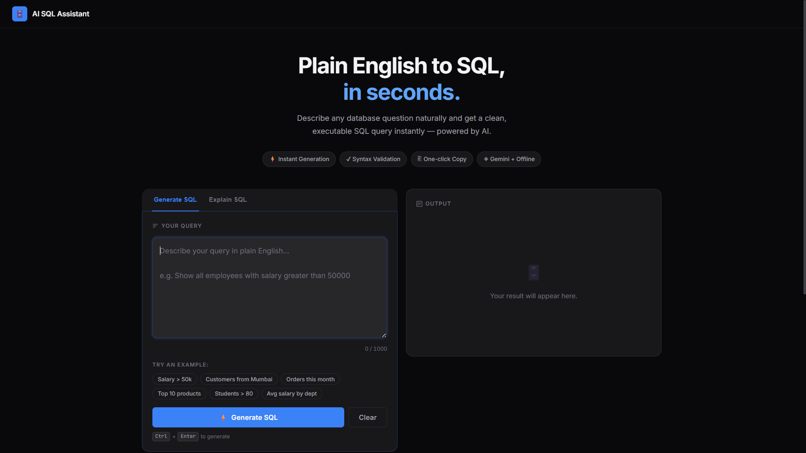
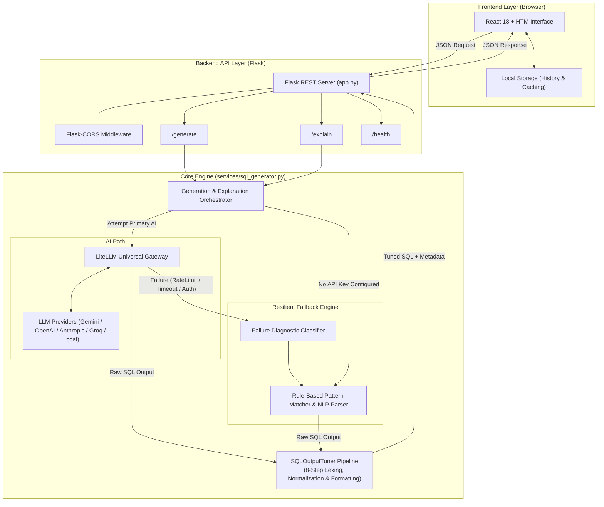
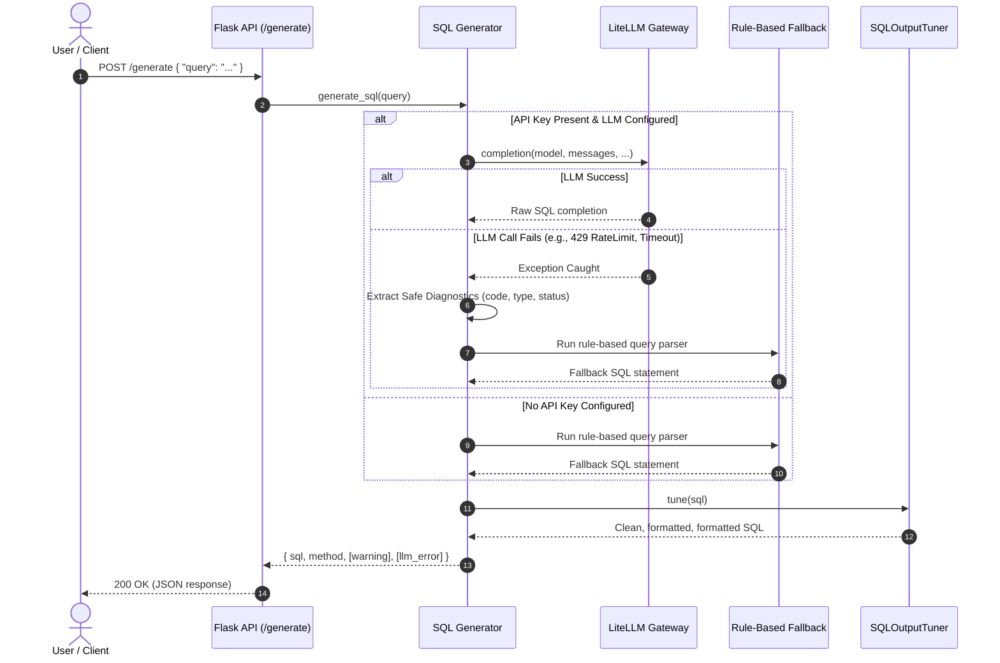

# 🗄️ AI SQL Assistant

<p align="center">
  <strong>Convert natural language queries into production-grade, formatted SQL statements instantly.</strong>
</p>

<p align="center">
  <a href="https://python.org"></a>
  <a href="https://flask.palletsprojects.com"></a>
  <a href="https://litellm.ai/"></a>
  <a href="https://react.dev"></a>
  <a href="LICENSE"></a>
  <a href="https://github.com/Avdhut15/AI_SQL_Assistant/actions"></a>
</p>

<p align="center">
  
</p>

---

## 📑 Table of Contents

- [Overview](#-overview)
- [System Architecture](#-system-architecture)
- [Key Features](#-key-features)
- [SQLOutputTuner Pipeline](#-sqloutputtuner-pipeline)
- [Supported LLM Providers](#-supported-llm-providers)
- [Quick Start](#-quick-start)
- [Environment Configuration](#-environment-configuration)
- [API Reference](#-api-reference)
- [Project Structure](#-project-structure)
- [Testing](#-testing)
- [Contributing](#-contributing)
- [License](#-license)

---

## 🌟 Overview

**AI SQL Assistant** is a full-stack, developer-friendly web application designed to bridge the gap between business inquiries and database management. By leveraging **LiteLLM** as a universal AI routing layer, the application seamlessly supports leading LLM providers (Google Gemini, OpenAI GPT, Anthropic Claude, Groq, Ollama) while maintaining an **offline rule-based NLP engine** with automated error diagnostics to guarantee zero downtime.

Whether you are writing queries from scratch, debugging clauses, or looking to understand an existing SQL snippet, AI SQL Assistant generates validated, syntax-tuned, and fully formatted SQL statements in milliseconds.

---

## 🏗️ System Architecture

The application adopts a modular layered architecture decoupling the frontend presentation, API gateway routing, dual-generation engines, and output tuning pipeline.



### Request & Fallback Flowchart



---

## ✨ Key Features

- **Universal Multi-LLM Support:** Backed by [LiteLLM](https://litellm.ai/), enabling instantaneous model switching (Google Gemini, OpenAI, Anthropic, Groq, Mistral, Ollama) without code refactoring.
- **Resilient Offline Fallback:** If you are offline or an LLM call fails (e.g., quota exhaustion, rate limiting, connection drop), the built-in rule-based NLP engine takes over automatically.
- **Actionable LLM Failure Diagnostics:** Detailed, secure diagnostics (`code`, `status_code`, `provider`, `model`) are returned with fallbacks so users and telemetry can track model availability.
- **SQL Explanation Engine:** Deconstructs complex queries into intuitive, plain-English step-by-step explanations via `POST /explain`.
- **`SQLOutputTuner` Pipeline:** An automated 8-stage post-processing pipeline that guarantees standard casing, indents clauses, normalizes operators, and fixes formatting quirks.
- **Zero-Build Lightweight Frontend:** Built with React 18 and `htm` directly in the browser—zero Node.js dependencies, npm installs, or bundling overhead.
- **Local History & Shortcuts:** Saves recent queries in `localStorage`, includes one-click clipboard copying, and supports the `Ctrl + Enter` shortcut for high-velocity workflows.

---

## 🧼 SQLOutputTuner Pipeline

All generated SQL statements pass through the `SQLOutputTuner` post-processing pipeline to ensure optimal syntax standardisation, formatting consistency, and readability:

| Stage | Operation | Description | Example Transformation |
|---|---|---|---|
| **1** | **Fence Removal** | Strips Markdown syntax fences (` ```sql ` / ` ``` `) | `` ```sql SELECT * ``` `` &rarr; `SELECT *` |
| **2** | **Keyword Uppercasing** | Uppercases SQL keywords and functions while preserving string literals | `select id, upper(name)` &rarr; `SELECT id, UPPER(name)` |
| **3** | **Whitespace Normalization**| Collapses consecutive tabs and spaces into single uniform blanks | `SELECT   id,    name` &rarr; `SELECT id, name` |
| **4** | **Clause Pretty-Printing** | Inserts indented line breaks before primary clauses | `SELECT id FROM table WHERE x = 1` &rarr; Multi-line formatted |
| **5** | **Semicolon Enforcement** | Verifies and appends a trailing termination semicolon | `SELECT * FROM tbl` &rarr; `SELECT * FROM tbl;` |
| **6** | **Operator Normalization** | Standardises spaced comparison operators | `< =`, `! =`, `< >` &rarr; `<=`, `!=`, `<>` |
| **7** | **Condition Deduplication**| Eliminates redundant consecutive `AND`/`WHERE` predicates | `WHERE a = 1 AND a = 1` &rarr; `WHERE a = 1` |
| **8** | **Parentheses Simplification**| Collapses redundant grouping parentheses around simple single literals | `WHERE (id = 5)` &rarr; `WHERE id = 5` |

---

## 🤖 Supported LLM Providers

LiteLLM supports 100+ providers. Configure your desired provider and model in `.env`:

| Provider | Target `LLM_MODEL` Example | Required API Key Env Var |
|---|---|---|
| **Google Gemini** *(Default)* | `gemini/gemini-3.1-flash-lite`<br>`gemini/gemini-2.5-flash` | `GEMINI_API_KEY` |
| **OpenAI** | `gpt-4o`<br>`gpt-4o-mini` | `OPENAI_API_KEY` |
| **Anthropic** | `claude-3-5-sonnet-20240620`<br>`claude-3-haiku-20240307` | `ANTHROPIC_API_KEY` |
| **Groq** | `groq/llama-3.3-70b-versatile` | `GROQ_API_KEY` |
| **Ollama (Local)** | `ollama/llama3` | *None (Local Server)* |

---

## 🚀 Quick Start

### Prerequisites
- **Python 3.9+** installed on your system.
- Git.

### 1. Clone the Repository
```bash
git clone https://github.com/Avdhut15/AI_SQL_Assistant.git
cd AI_SQL_Assistant
```

### 2. Create & Activate a Virtual Environment

**Windows (PowerShell):**
```powershell
python -m venv venv
.\venv\Scripts\Activate.ps1
```

**macOS / Linux:**
```bash
python3 -m venv venv
source venv/bin/activate
```

### 3. Install Dependencies
```bash
pip install -r requirements.txt
```

*(Optional: Install test and development packages via `pip install -r requirements-dev.txt`)*

### 4. Configure Environment
Create your `.env` file from the example template:

```bash
# Windows
copy .env.example .env

# macOS / Linux
cp .env.example .env
```

Open `.env` and set your preferred model and corresponding API key (e.g., `GEMINI_API_KEY`).

### 5. Run the Application
```bash
python app.py
```

Access the interface in your browser at: **`http://localhost:5000`**

---

## ⚙️ Environment Configuration

| Variable | Type | Default | Description |
|---|---|---|---|
| `LLM_MODEL` | `string` | `gemini/gemini-3.1-flash-lite` | Universal LiteLLM model identifier |
| `GEMINI_API_KEY` | `string` | — | Google Gemini API Key |
| `OPENAI_API_KEY` | `string` | — | OpenAI API Key |
| `ANTHROPIC_API_KEY` | `string` | — | Anthropic API Key |
| `GROQ_API_KEY` | `string` | — | Groq Cloud API Key |
| `LLM_TEMPERATURE` | `float` | `0.1` | Sampling temperature for query generation |
| `LLM_MAX_TOKENS` | `int` | `768` | Maximum output tokens generated by the LLM |
| `PORT` | `int` | `5000` | Port for the Flask application server |
| `FLASK_DEBUG` | `bool` | `false` | Enable/disable Flask debug reload mode |
| `MAX_QUERY_LENGTH` | `int` | `1000` | Maximum character length accepted per natural query |

---

## 🔌 API Reference

### 1. Generate SQL
Converts natural language input into a formatted SQL query.

- **Endpoint:** `POST /generate`
- **Headers:** `Content-Type: application/json`

**Request:**
```json
{
  "query": "Show all active customers from Mumbai ordered by sign up date descending"
}
```

**Successful LLM Response (`200 OK`):**
```json
{
  "sql": "SELECT *\n    FROM customers\n    WHERE status = 'active'\n      AND city = 'Mumbai'\n    ORDER BY sign_up_date DESC;",
  "method": "llm"
}
```

**Fallback Response with Diagnostics (`200 OK`):**
*Returned when an LLM provider fails due to rate limits or API errors, gracefully returning rule-based output without crashing.*
```json
{
  "sql": "SELECT *\n    FROM customers\n    WHERE city = 'Mumbai';",
  "method": "rule-based",
  "warning": "LLM generation failed; the rule-based fallback was used.",
  "llm_error": {
    "code": "rate_limit",
    "message": "The LLM provider rate limit was exceeded. Try again later.",
    "type": "RateLimitError",
    "status_code": 429,
    "provider": "gemini",
    "model": "gemini/gemini-3.1-flash-lite"
  }
}
```

---

### 2. Explain SQL Query
Analyzes and decomposes an SQL query into a structured, step-by-step breakdown.

- **Endpoint:** `POST /explain`
- **Headers:** `Content-Type: application/json`

**Request:**
```json
{
  "sql": "SELECT department, AVG(salary) FROM employees GROUP BY department HAVING AVG(salary) > 60000;"
}
```

**Response (`200 OK`):**
```json
{
  "explanation": "1. **SELECT department, AVG(salary)**: Retrieves the department name and computes the average salary for each group.\n2. **FROM employees**: Targets the employees table.\n3. **GROUP BY department**: Aggregates records by unique department values.\n4. **HAVING AVG(salary) > 60000**: Filters aggregated groups where the calculated average salary exceeds 60,000.",
  "method": "llm"
}
```

---

### 3. Health Check
Endpoint for uptime monitors and orchestrator health probes.

- **Endpoint:** `GET /health`

**Response (`200 OK`):**
```json
{
  "status": "ok",
  "service": "AI SQL Assistant"
}
```

---

## 📁 Project Structure

```text
AI_SQL_Assistant/
├── .env.example                  # Environment configuration template
├── .gitignore                    # Git ignore configurations
├── app.py                        # Flask server, route controllers & error handlers
├── LICENSE                       # MIT License file
├── README.md                     # Comprehensive project documentation
├── requirements.txt              # Production runtime dependencies
├── requirements-dev.txt          # Development & test dependencies
├── _smoke_test.py                # Standalone smoke test utility
├── screenshots/
│   └── preview.png               # High-resolution application preview screenshot
├── services/
│   ├── __init__.py               # Service package initialization
│   └── sql_generator.py          # AI orchestration, LiteLLM gateway, rule-based NLP, and SQLOutputTuner
├── static/
│   ├── script.js                 # React 18 + HTM frontend client logic & state store
│   └── style.css                 # Dark theme, syntax highlighting & UI styling
├── templates/
│   └── index.html                # Single-page HTML shell
└── tests/
    └── test_llm_fallback_diagnostics.py  # Unit & integration tests for fallback diagnostics
```

---

## 🧪 Testing

The test suite covers API routes, fallback mechanisms, error diagnostic structures, and the output tuner pipeline.

Run the test suite with `pytest`:

```bash
# Run all unit and integration tests
pytest tests/ -v
```

Execute the standalone smoke check:

```bash
python _smoke_test.py
```

---

## 🤝 Contributing

Contributions are welcomed! Follow these steps to contribute:

1. **Fork** the repository.
2. **Create a Feature Branch:** `git checkout -b feature/your-feature-name`
3. **Commit Your Changes:** `git commit -m "feat: add awesome new capability"`
4. **Push to Your Branch:** `git push origin feature/your-feature-name`
5. **Open a Pull Request** describing your additions or fixes.

---

## 📄 License

This project is open-source and released under the terms of the [MIT License](LICENSE).
